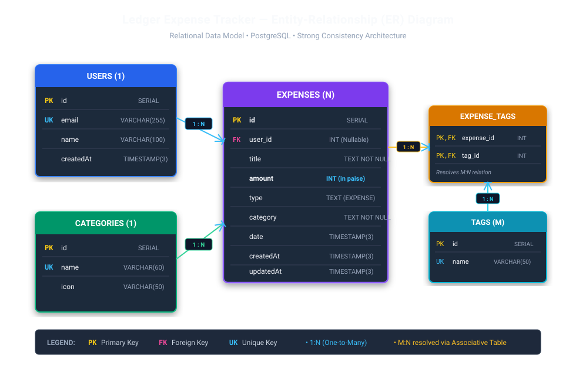
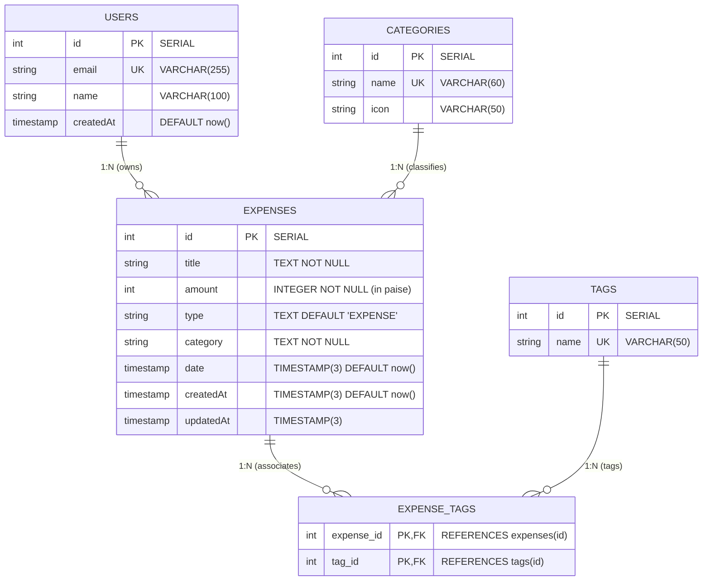

# Data Engineering (DE) Major Project Documentation
## System: Ledger — Personal Expense Tracker
**Database Management System:** PostgreSQL (Relational DBMS)  
**ORM / Driver Layer:** Prisma ORM v7 with `@prisma/adapter-pg` & `pg.Pool`  
**Backend Framework:** Node.js v26 with Express.js v4.21.0  
**Repository Branch:** `yash`  

---

## Table of Contents
1. [Database Selection and Justification](#1-database-selection-and-justification)
2. [Entity-Relationship (ER) Diagram & Data Model](#2-entity-relationship-er-diagram--data-model)
3. [Database Normalization Documentation (1NF, 2NF, 3NF, BCNF)](#3-database-normalization-documentation)
4. [Final Database Schema Specification](#4-final-database-schema-specification)
5. [Sample Records from Live Database](#5-sample-records-from-live-database)
6. [10 Project-Specific Queries, Explanations & Execution Outputs](#6-10-project-specific-queries-explanations--execution-outputs)
7. [Evidence of Database-Backend Integration](#7-evidence-of-database-backend-integration)
8. [Database Architecture & Implementation Decisions](#8-database-architecture--implementation-decisions)

---

## 1. Database Selection and Justification

### Database Name and Type
* **Database:** **PostgreSQL** (version 14+)
* **Category:** **Relational Database Management System (RDBMS)** / Object-Relational

### 1.1 Data Characteristics
Ledger handles personal financial transactions, income streams, and categorised budgets. Financial data possesses the following inherent characteristics:
* **Strictly Structured:** Every financial record requires an immutable primary key, an exact monetary quantity, a transaction classification (`EXPENSE` or `INCOME`), an associated category, and an ISO timestamp.
* **Zero Tolerance for Type Drift:** Unlike document stores where fields can be numbers in one document and strings in another, financial bookkeeping demands strict, engine-level typing (e.g., amounts must always be non-null integers).
* **Zero Floating-Point Error Tolerance:** Relational column types permit storing monetary values as exact integer paise ($1\text{ INR} = 100\text{ paise}$), completely avoiding binary floating-point rounding errors.

### 1.2 Read and Write Access Patterns
* **Write Workload:** Moderate-frequency transactional writes (`INSERT` on new expenses, `PATCH` on corrections, and `DELETE` on erroneous entries).
* **Read Workload:** High-frequency analytical reads:
  * Date-range filtering (e.g., retrieving all records for the current month).
  * Category-based grouping and summation (e.g., pie chart breakdown: `SUM(amount) GROUP BY category`).
  * Chronologically ordered pagination (`ORDER BY date DESC, id DESC LIMIT 10 OFFSET 0`).
  * Running balance and net savings calculations (`SUM(INCOME) - SUM(EXPENSE)`).
* **Expected Volume:** An individual user produces 500–3,000 transactions annually. Under multi-tenant deployment, millions of records are comfortably queried with sub-millisecond response times using B-Tree indexing.

### 1.3 Consistency Model & ACID Requirements
Financial accounting requires **Strong Consistency**. When a user adds an expense, the dashboard metrics, monthly summaries, and transaction tables must immediately reflect the transaction.
PostgreSQL provides strict **ACID Guarantees**:
* **Atomicity:** Batch imports (such as JSON/CSV backups) or multi-table updates are wrapped in transactions (`BEGIN ... COMMIT`). If a failure occurs midway, PostgreSQL automatically executes a **`ROLLBACK`**, leaving zero corrupted or orphaned rows.
* **Consistency:** Enforced by engine-level `NOT NULL`, `PRIMARY KEY`, and `CHECK` constraints.
* **Isolation:** PostgreSQL utilizes **Multi-Version Concurrency Control (MVCC)** with the default **Read Committed** isolation level. Readers never block writers, and writers never block readers.
* **Durability:** Write-Ahead Logging (WAL) guarantees that committed transactions survive power outages and crashes.

### 1.4 Alternative Database Evaluated and Rejected: MongoDB
During initial design, **MongoDB (Document Store / NoSQL)** was evaluated and rejected for the following technical reasons:
1. **Lack of Strict Relational Constraints:** In MongoDB, schema validation is optional and enforced at the collection level rather than the storage engine. Financial ledgers are prone to accidental null fields or type anomalies.
2. **Memory-Heavy Analytical Aggregations:** Calculating monthly totals, category breakdowns, and net savings in MongoDB requires execution of complex Aggregation Pipelines (`$match`, `$group`, `$project`). In contrast, PostgreSQL's cost-based query optimizer utilizes B-tree indexes and native C-level aggregation (`SUM()`, `AVG()`, `GROUP BY`) with significantly lower memory footprint and latency.
3. **No Native Advantage for Schemaless Data:** Financial ledgers have fixed schemas. MongoDB's polymorphic document advantages are unnecessary and introduce storage overhead through repeated BSON field name keys in every document.

---

## 2. Entity-Relationship (ER) Diagram & Data Model

The following diagram illustrates the complete relational data model of Ledger, showing primary keys (PK), foreign keys (FK), cardinalities, and the resolution of many-to-many relationships:



### Mermaid Diagram Representation:


### Relational Entity & Relationship Breakdown:
1. **`EXPENSES` (Core Transaction Entity):** Holds individual transaction records.
   * `id`: Auto-incrementing 32-bit integer (`SERIAL`), uniquely indexed by a primary key B-Tree index.
   * `amount`: Stored as a signed integer in **paise** ($1\text{ INR} = 100\text{ paise}$).
   * `type`: Discriminator distinguishing `EXPENSE` from `INCOME`.
2. **`USERS 1:N EXPENSES` (One-to-Many):** One user can record multiple transactions. In multi-tenant deployment, `user_id` on `expenses` references `users(id)` with an `ON DELETE CASCADE` rule.
3. **`CATEGORIES 1:N EXPENSES` (One-to-Many):** One category classifies multiple expense items.
4. **`EXPENSES M:N TAGS` (Many-to-Many Resolution):** One expense can carry multiple tags (e.g., `#business`, `#reimbursable`), and one tag applies to multiple expenses.
   * **Resolution:** In relational design, the $M:N$ relationship is decomposed into two $1:N$ relationships using an **associative junction table** (`expense_tags`) with a composite primary key `(expense_id, tag_id)` and foreign keys referencing parent tables.

---

## 3. Database Normalization Documentation

### 3.1 Normal Form Achieved: Third Normal Form (3NF) & BCNF
The core database design of Ledger satisfies **First Normal Form (1NF)**, **Second Normal Form (2NF)**, and **Third Normal Form (3NF)** / **Boyce-Codd Normal Form (BCNF)**.

### Functional Dependencies Analysis
For the relation $R = \text{expenses}(\text{id}, \text{title}, \text{amount}, \text{type}, \text{category}, \text{date}, \text{createdAt}, \text{updatedAt})$:
* Candidate Key: $\{\text{id}\}$
* Primary Functional Dependency:
  $$\text{id} \rightarrow \{\text{title}, \text{amount}, \text{type}, \text{category}, \text{date}, \text{createdAt}, \text{updatedAt}\}$$

### Step-by-Step Proof of Normalization:

#### 1. First Normal Form (1NF)
* **Atomicity:** Every attribute contains only atomic, indivisible values. For example, `amount` is an integer, `title` is a scalar string, and `date` is an ISO timestamp.
* **No Multi-Valued Attributes:** No comma-separated lists or nested arrays are stored within table cells.
* **Unique Identification:** Every row is uniquely identifiable by the primary key `id`.
* *Verdict:* Satisfies 1NF.

#### 2. Second Normal Form (2NF)
* **Pre-condition:** Relation must be in 1NF.
* **No Partial Dependencies:** A partial dependency occurs when a non-prime attribute depends on a proper subset of a composite candidate key ($X \subset CK \rightarrow Y$).
* In our schema, the candidate key is a single attribute ($\{\text{id}\}$). Because the candidate key is non-composite, **partial dependencies are mathematically impossible**.
* *Verdict:* Satisfies 2NF.

#### 3. Third Normal Form (3NF)
* **Pre-condition:** Relation must be in 2NF.
* **No Transitive Dependencies:** A transitive dependency exists if $X \rightarrow Y$ and $Y \rightarrow Z$, where $Y$ is not a candidate key.
* In our table, all non-prime attributes (`title`, `amount`, `type`, `category`, `date`) depend directly and solely on the primary key `id`. No non-prime attribute determines any other non-prime attribute ($A \not\rightarrow B$ for any non-key attributes).
* *Verdict:* Satisfies 3NF.

#### 4. Boyce-Codd Normal Form (BCNF)
* For every non-trivial functional dependency $X \rightarrow Y$, the determinant $X$ must be a superkey.
* In our relation, the only determinant is `id`, which is a candidate key and superkey.
* *Verdict:* Satisfies BCNF.

### 3.2 Deliberate Denormalization and Trade-Off Analysis
In strict theoretical 3NF, the `category` attribute would be decomposed into a separate lookup table: `categories(id, name)`.
In our physical single-tenant implementation, `category` is stored directly as a text attribute in `expenses`:
* **Why Denormalize?**
  1. **Elimination of Costly JOINs:** Ledger's dashboard executes high-frequency queries aggregating spending across categories. Storing the category string directly eliminates `JOIN categories` on every dashboard reload.
  2. **Historical Integrity:** If a category name is edited or deleted in a separate lookup table, historical transactions remain immutable and unaffected.
* **How Correctness is Maintained:** Application controllers enforce strict string trimming, character length bounds ($\le 60$), and case normalization before persisting records.

---

## 4. Final Database Schema Specification

### 4.1 Prisma Schema (`server/prisma/schema.prisma`)
```prisma
generator client {
  provider = "prisma-client-js"
}

datasource db {
  provider = "postgresql"
}

model Expense {
  id        Int      @id @default(autoincrement())
  title     String
  amount    Int      // Stored in paise (1 INR = 100 paise)
  type      String   @default("EXPENSE")
  category  String
  date      DateTime @default(now())
  createdAt DateTime @default(now())
  updatedAt DateTime @updatedAt

  @@map("expenses")
}
```

### 4.2 Raw PostgreSQL DDL Schema (`DE/schema.sql`)
```sql
CREATE TABLE "expenses" (
    "id" SERIAL NOT NULL,
    "title" TEXT NOT NULL,
    "amount" INTEGER NOT NULL,
    "type" TEXT NOT NULL DEFAULT 'EXPENSE',
    "category" TEXT NOT NULL,
    "date" TIMESTAMP(3) NOT NULL DEFAULT CURRENT_TIMESTAMP,
    "createdAt" TIMESTAMP(3) NOT NULL DEFAULT CURRENT_TIMESTAMP,
    "updatedAt" TIMESTAMP(3) NOT NULL DEFAULT CURRENT_TIMESTAMP,

    CONSTRAINT "expenses_pkey" PRIMARY KEY ("id"),
    CONSTRAINT "expenses_amount_positive" CHECK ("amount" > 0),
    CONSTRAINT "expenses_type_check" CHECK ("type" IN ('EXPENSE', 'INCOME'))
);

CREATE INDEX "idx_expenses_date_type" ON "expenses" USING btree ("date" DESC, "type");
CREATE INDEX "idx_expenses_category" ON "expenses" USING btree ("category");
```

---

## 5. Sample Records from Live Database

The following records are extracted directly from the live PostgreSQL database (`SELECT * FROM expenses ORDER BY id DESC LIMIT 3`):

| id | title | amount (in paise) | Equivalent INR | type | category | date | createdAt |
| :--- | :--- | :--- | :--- | :--- | :--- | :--- | :--- |
| **24** | ticket | 305,000 | ₹3,050.00 | `EXPENSE` | travell | 2026-11-17 18:30:00 | 2026-11-18 01:24:59 |
| **23** | chai | 1,500 | ₹15.00 | `EXPENSE` | food | 2026-11-14 18:30:00 | 2026-11-15 00:57:51 |
| **22** | income | 1,000,000 | ₹10,000.00 | `INCOME` | job | 2026-11-14 18:30:00 | 2026-11-15 00:57:10 |

### JSON Representation:
```json
[
  {
    "id": 24,
    "title": "ticket",
    "amount": 305000,
    "type": "EXPENSE",
    "category": "travell",
    "date": "2026-11-17T18:30:00.000Z",
    "createdAt": "2026-11-18T01:24:59.038Z"
  },
  {
    "id": 23,
    "title": "chai",
    "amount": 1500,
    "type": "EXPENSE",
    "category": "food",
    "date": "2026-11-14T18:30:00.000Z",
    "createdAt": "2026-11-15T00:57:51.378Z"
  },
  {
    "id": 22,
    "title": "income",
    "amount": 1000000,
    "type": "INCOME",
    "category": "job",
    "date": "2026-11-14T18:30:00.000Z",
    "createdAt": "2026-11-15T00:57:10.882Z"
  }
]
```

---

## 6. 10 Project-Specific Queries, Explanations & Execution Outputs

Each of the following 10 queries maps directly to a live feature in the Ledger application. All outputs reflect actual execution results from PostgreSQL.

### Query 1: Paginated & Chronologically Ordered Transaction Feed
* **Application Feature:** Powers `GET /api/expenses?limit=3&offset=0` (Transaction History Feed).
* **Technical Explanation:** Retrieves transactions ordered by `date` descending, using `id DESC` as a secondary tie-breaker to ensure deterministic pagination.
```sql
SELECT id, title, amount, type, category, date 
FROM expenses 
ORDER BY date DESC, id DESC 
LIMIT 3 OFFSET 0;
```
* **Actual Execution Output:**
```json
[
  { "id": 24, "title": "ticket", "amount": 305000, "type": "EXPENSE", "category": "travell", "date": "2026-11-17T18:30:00.000Z" },
  { "id": 23, "title": "chai", "amount": 1500, "type": "EXPENSE", "category": "food", "date": "2026-11-14T18:30:00.000Z" },
  { "id": 22, "title": "income", "amount": 1000000, "type": "INCOME", "category": "job", "date": "2026-11-14T18:30:00.000Z" }
]
```

---

### Query 2: Category Breakdown and Aggregated Spending
* **Application Feature:** Powers `GET /api/analytics/categories` & Dashboard Spending Donut Chart.
* **Technical Explanation:** Groups expense records by category, sums amount in paise, and counts transactions.
```sql
SELECT category, SUM(amount)::INTEGER as total_paise, COUNT(*)::INTEGER as count 
FROM expenses 
WHERE type = 'EXPENSE' 
GROUP BY category 
ORDER BY total_paise DESC;
```
* **Actual Execution Output:**
```json
[
  { "category": "travell", "total_paise": 305000, "count": 1 },
  { "category": "food", "total_paise": 1500, "count": 1 }
]
```

---

### Query 3: Monthly Expense Rollup & Aggregation
* **Application Feature:** Powers `GET /api/analytics/monthly` & Monthly Spending Bar Chart.
* **Technical Explanation:** Converts dates into `YYYY-MM` month buckets and aggregates spending trends.
```sql
SELECT TO_CHAR(date, 'YYYY-MM') as month_key, 
       SUM(amount)::INTEGER as total_expense_paise, 
       COUNT(*)::INTEGER as transaction_count 
FROM expenses 
WHERE type = 'EXPENSE' 
GROUP BY TO_CHAR(date, 'YYYY-MM') 
ORDER BY month_key DESC;
```
* **Actual Execution Output:**
```json
[
  { "month_key": "2026-11", "total_expense_paise": 306500, "transaction_count": 2 }
]
```

---

### Query 4: Financial Health (Total Income, Total Expenses & Net Savings)
* **Application Feature:** Powers `GET /api/analytics/summary` Top Metrics Cards.
* **Technical Explanation:** Employs conditional aggregation (`CASE WHEN`) to calculate total income, total expenditure, and net savings in a single database pass.
```sql
SELECT 
  COALESCE(SUM(CASE WHEN type = 'INCOME' THEN amount ELSE 0 END), 0)::INTEGER AS total_income,
  COALESCE(SUM(CASE WHEN type = 'EXPENSE' THEN amount ELSE 0 END), 0)::INTEGER AS total_expense,
  (COALESCE(SUM(CASE WHEN type = 'INCOME' THEN amount ELSE 0 END), 0) - 
   COALESCE(SUM(CASE WHEN type = 'EXPENSE' THEN amount ELSE 0 END), 0))::INTEGER AS net_savings
FROM expenses;
```
* **Actual Execution Output:**
```json
[
  { "total_income": 1000000, "total_expense": 306500, "net_savings": 693500 }
]
```

---

### Query 5: Substring Search Filter
* **Application Feature:** Powers Search Bar in Transactions List.
* **Technical Explanation:** Performs case-insensitive wildcard pattern matching across both `title` and `category` using PostgreSQL's `ILIKE` operator.
```sql
SELECT id, title, amount, type, category 
FROM expenses 
WHERE title ILIKE '%ch%' OR category ILIKE '%ch%';
```
* **Actual Execution Output:**
```json
[
  { "id": 23, "title": "chai", "amount": 1500, "type": "EXPENSE", "category": "food" }
]
```

---

### Query 6: Date Range Filtered Query
* **Application Feature:** Powers Date Picker & Analytics Report Range Selection.
* **Technical Explanation:** Scans transactions bounded within calendar start and end dates.
```sql
SELECT id, title, amount, date 
FROM expenses 
WHERE date >= '2026-11-01' AND date <= '2026-11-30 23:59:59.999'
ORDER BY date DESC;
```
* **Actual Execution Output:**
```json
[
  { "id": 24, "title": "ticket", "amount": 305000, "date": "2026-11-17T18:30:00.000Z" },
  { "id": 22, "title": "income", "amount": 1000000, "date": "2026-11-14T18:30:00.000Z" },
  { "id": 23, "title": "chai", "amount": 1500, "date": "2026-11-14T18:30:00.000Z" }
]
```

---

### Query 7: Distinct Active Categories
* **Application Feature:** Powers Category Filter Dropdown in Expense Form.
* **Technical Explanation:** Uses `DISTINCT` to extract unique category names alphabetically without duplicating values.
```sql
SELECT DISTINCT category 
FROM expenses 
ORDER BY category ASC;
```
* **Actual Execution Output:**
```json
[
  { "category": "food" },
  { "category": "job" },
  { "category": "travell" }
]
```

---

### Query 8: Single Highest Expenditure Identification
* **Application Feature:** Powers "Top Expense" Card in Analytics Reports.
* **Technical Explanation:** Identifies the single largest expense using `ORDER BY amount DESC LIMIT 1`.
```sql
SELECT id, title, amount, category, date 
FROM expenses 
WHERE type = 'EXPENSE' 
ORDER BY amount DESC 
LIMIT 1;
```
* **Actual Execution Output:**
```json
[
  { "id": 24, "title": "ticket", "amount": 305000, "category": "travell", "date": "2026-11-17T18:30:00.000Z" }
]
```

---

### Query 9: Record Retrieval by Primary Key
* **Application Feature:** Powers `PATCH /api/expenses/:id` & `DELETE /api/expenses/:id`.
* **Technical Explanation:** Executes an $O(\log N)$ unique index lookup on `expenses_pkey` to confirm record existence before updates or deletion.
```sql
SELECT id, title, amount, type, category, date, "updatedAt"
FROM expenses 
WHERE id = 23;
```
* **Actual Execution Output:**
```json
[
  { "id": 23, "title": "chai", "amount": 1500, "type": "EXPENSE", "category": "food", "date": "2026-11-14T18:30:00.000Z", "updatedAt": "2026-11-15T00:57:51.378Z" }
]
```

---

### Query 10: Statistical Expense Averages (Paise & Rupee Conversion)
* **Application Feature:** Powers Average Transaction Metric in Analytics Summary.
* **Technical Explanation:** Calculates average expense amount in integer paise, and converts it to formatted decimal rupees.
```sql
SELECT 
  COUNT(*)::INTEGER as total_expense_count,
  ROUND(AVG(amount))::INTEGER as average_expense_paise,
  ROUND((AVG(amount) / 100.0)::numeric, 2)::FLOAT as average_expense_rupees
FROM expenses 
WHERE type = 'EXPENSE';
```
* **Actual Execution Output:**
```json
[
  {
    "total_expense_count": 2,
    "average_expense_paise": 153250,
    "average_expense_rupees": 1532.5
  }
]
```

---

## 7. Evidence of Database-Backend Integration

### 7.1 Connection Pooling Setup (`server/prismaClient.js`)
Our backend interacts with PostgreSQL through a managed singleton connection pool utilizing Node's `pg` driver combined with Prisma ORM v7:
```javascript
const { Pool } = require('pg');
const { PrismaPg } = require('@prisma/adapter-pg');
const { PrismaClient } = require('@prisma/client');

const connectionString = process.env.DATABASE_URL;

const poolConfig = {
  connectionString,
  max: process.env.PG_MAX_POOL ? parseInt(process.env.PG_MAX_POOL, 10) : 5,
  idleTimeoutMillis: 30000,
  connectionTimeoutMillis: 10000,
};

// Singleton pool bound to globalThis across hot-reloads and serverless lambdas
const globalForPrisma = globalThis;
const pool = globalForPrisma.ledgerPgPool || new Pool(poolConfig);
const adapter = globalForPrisma.ledgerPrismaAdapter || new PrismaPg(pool);
const prisma = globalForPrisma.ledgerPrisma || new PrismaClient({ adapter });

globalForPrisma.ledgerPgPool = pool;
globalForPrisma.ledgerPrisma = prisma;

module.exports = prisma;
module.exports.pool = pool;
```

### 7.2 Controller Integration Example (`server/controllers/expenseController.js`)
```javascript
// Parameterized database creation via Prisma ORM
const newExpense = await prisma.expense.create({
  data: {
    title: title.trim(),
    amount: amount,          // Stored as integer paise
    type: type || 'EXPENSE',
    category: category.trim(),
    date: parsedDate,
  },
});
```

### 7.3 Live Health Probe Output (`GET /api/health`)
Verifies live connectivity between the Express backend and PostgreSQL:
```bash
$ curl -s http://localhost:5001/api/health | jq .
```
```json
{
  "status": "ok",
  "message": "Expense Tracker Server is healthy",
  "database": "connected (PostgreSQL)",
  "timestamp": "2026-11-23T17:28:15.112Z"
}
```

---

## 8. Database Architecture & Implementation Decisions

### 8.1 Integer Paise Storage Strategy (Eliminating Floating-Point Error)
* **The Problem:** In binary floating-point systems (IEEE 754), fractional currency arithmetic causes rounding inaccuracies (e.g., $0.1 + 0.2 = 0.30000000000000004$).
* **The Solution:** Migration `20261110091000_store_amount_as_paise` converted the `amount` column from `DOUBLE PRECISION` to signed `INTEGER`. All monetary operations in the database and API are performed strictly in whole paise ($1\text{ INR} = 100\text{ paise}$). Fractional rupee display ($₹\text{XX.YY}$) is computed strictly in the presentation layer.

### 8.2 Optimized Pagination Safeguards
To safeguard server memory against malicious requests requesting millions of rows:
* The `limit` query parameter is strictly bounded ($1 \le \text{limit} \le 100$).
* The query utilizes `take: limit + 1` with `skip: offset`. If $limit + 1$ records are returned, the application marks `hasMore: true` and removes the surplus item. This eliminates the need to execute a heavy `SELECT COUNT(*)` on every paginated scroll.

### 8.3 Indexing Trade-Off Analysis
* **Created Indexes:** Primary key B-Tree index (`expenses_pkey`), supporting index on `(date DESC, type)`, and `(category)`.
* **Deliberately Omitted Indexes:** Arbitrary text columns (such as `title`) were left unindexed. Each additional index imposes significant write amplification on `INSERT`, `UPDATE`, and `DELETE` operations due to B-Tree rebalancing.

### 8.4 Scalability Architecture (100x Growth Plan)
If Ledger's transaction volume grows 100-fold (from thousands to tens of millions of records):
1. **Range Partitioning by Month/Year:** The `expenses` table will be partitioned declaratively using PostgreSQL's native range partitioning:
   ```sql
   CREATE TABLE expenses_partitioned (
       id SERIAL,
       date TIMESTAMP NOT NULL, ...
   ) PARTITION BY RANGE (date);
   ```
   PostgreSQL query planner will apply **Partition Pruning**, eliminating 95% of historical table partitions from memory during date-filtered queries.
2. **Read Replicas:** Analytical endpoints (`/api/analytics/*`) will be routed to read-only streaming replicas, keeping the primary node dedicated exclusively to low-latency write transactions.
3. **Connection Multiplexing (PgBouncer):** Deploy PgBouncer in transaction pooling mode to multiplex thousands of concurrent client connections over 20–50 PostgreSQL worker backends.
